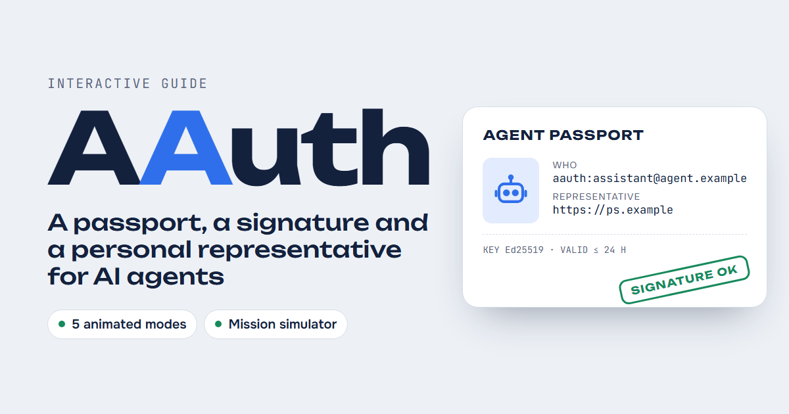

# AAuth Explained

**An interactive visual guide to AAuth, the IETF draft protocol for AI agent authorization.**

👉 **English:** https://nibrmi.github.io/aauth/en/
👉 **Русский:** https://nibrmi.github.io/aauth/

[](https://nibrmi.github.io/aauth/en/)

AAuth ([draft-hardt-oauth-aauth-protocol](https://datatracker.ietf.org/doc/draft-hardt-oauth-aauth-protocol/), by Dick Hardt) gives every AI agent its own cryptographic identity and signs every request it makes, so no token works in a thief's hands and nothing needs pre-registration. A Person Server represents the human the agent acts for, and Access Servers apply each service's policy across trust domains.

This page explains it without the jargon:

- **Try to steal a token**: see why a bearer token works for a thief and an AAuth token doesn't.
- **Six parties**: agent, agent provider, service, Person Server, Access Server and the person.
- **Four tokens**: agent token, person token, resource token and auth token, plus the session token.
- **Five access modes**, animated step by step: agent identity, resource-managed, person identity, PS authorization (three-party) and federated (four-party).
- **The agent loop**: request, read `AAuth-Requirement`, satisfy it, retry.
- **Mission simulator**: play the human while an agent plans a trip under a mission.
- **AAuth vs OAuth** comparison and an FAQ.

Based on draft-hardt-oauth-aauth-protocol-11 (September 2026). Unofficial; not affiliated with the IETF or the protocol's author.

## Official AAuth resources

- Specification: https://datatracker.ietf.org/doc/draft-hardt-oauth-aauth-protocol/
- Source and companion drafts: https://github.com/dickhardt/AAuth
- aauth.dev and the AAuth Explorer: https://www.aauth.dev

## Building

The Russian page is the source. `tools/en.txt` holds the English translation, one Russian line and one English line per pair.

```
python tools/build.py src/ru.html
```

This writes `index.html` and `en/index.html`, and fails if a translation no longer matches the source or any Russian text is left on the English page.
